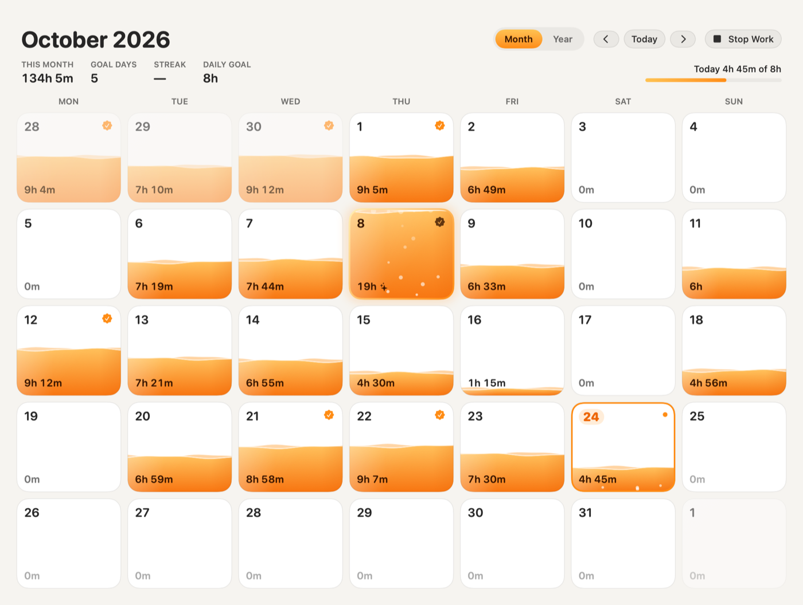
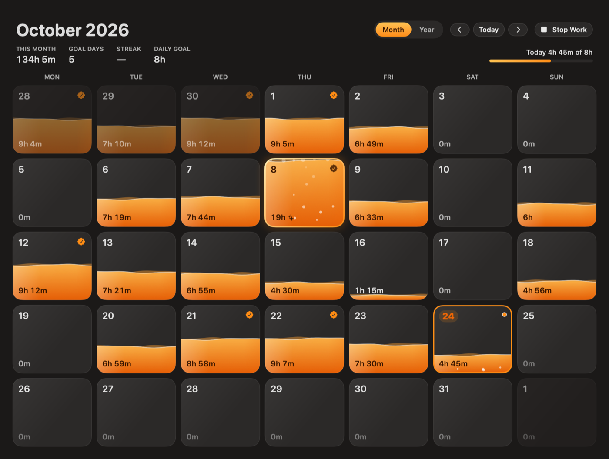
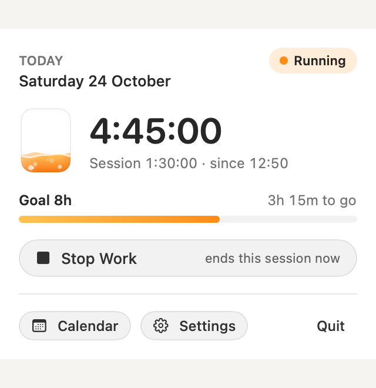
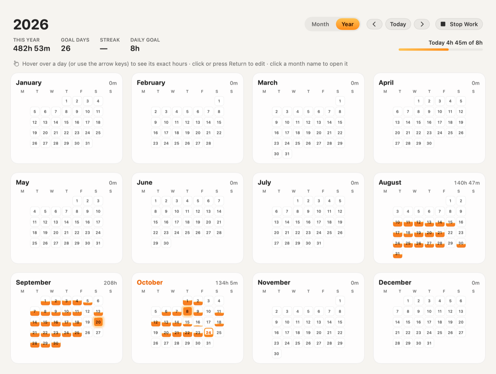

# Workday

**A native macOS work-hours tracker where every day is a glass of orange liquid.**

Workday lives in your menu bar. Press **Start Work**, press **Stop Work** — that's the only way time is recorded.
The calendar fills each day with translucent, gently moving orange liquid: empty at 0 hours, full at 18,
glowing and overflowing beyond that, always labelled with the exact time worked.

Fully offline. No account, no cloud, no analytics. Your work history never leaves your Mac.

<p align="center">
  
</p>

<p align="center">
  
  
</p>

## Features

* **Menu bar timer** — a small orange glass that fills toward today's goal, plus today's total (e.g. `6:35`).
  The dropdown shows the live session, goal progress, streak and a clearly labelled Start/Stop.
* **Liquid calendar** — month view with weekday-aligned tiles, and a twelve-month overview. Waves, sloshing,
  pour-in on changes, bubbles on the day being timed and a glowing overflow beyond 18 hours. Respects Reduce Motion.
* **Session editor** — click any day to add, edit or delete sessions, with validation (no overlaps, no future
  time) and a preview when a change affects other days. Sessions crossing midnight are split correctly.
* **Crash-safe** — sleep counts as work while the timer runs; if the app quits unexpectedly or the Mac shuts down,
  Workday keeps the confirmed time and asks you how to count the uncertain gap.
* **Goal and streak** — one daily goal (default 8 h), a streak of days that met it, an optional goal-reached
  notification and start/stop reminders.
* **Local backups** — automatic daily snapshots with validation and one-click restore.
* **Accessible** — VoiceOver labels with the full date and exact hours, keyboard navigation, light and dark mode.

<p align="center">
  
</p>

## Install

Download `Workday-<version>-macOS.dmg` (or `.zip`) from
[Releases](../../releases), open it and drag **Workday** to **Applications**.

Requirements: **macOS 14 Sonoma or later**, Apple Silicon or Intel.

> Release builds are currently **ad-hoc signed and not notarised**, so macOS asks you to confirm the first launch:
>
> * **macOS 15 Sequoia and later:** open Workday once and dismiss the warning, then go to **System Settings →
>   Privacy & Security**, find *"Workday" was blocked…* and click **Open Anyway**.
> * **macOS 14 Sonoma:** right-click Workday in Applications → **Open** → **Open**.
>
> Verify the download with `shasum -a 256 -c SHA256SUMS.txt`. See [docs/RELEASING.md](docs/RELEASING.md) for how
> notarised builds are produced once a Developer ID is configured.

On first launch Workday opens its calendar once and registers itself to start at login (you can turn that off in
Settings → General). After that it starts quietly in the menu bar. Updating replaces only the app — your data in
`~/Library/Application Support/Workday/` is kept.

## Build from source

Requirements: macOS 14+, Swift 6 toolchain — either **Xcode 16+** or just the **Command Line Tools**
(`xcode-select --install`). No third-party dependencies.

```bash
git clone https://github.com/Plainset/workday.git
cd workday
./scripts/test.sh            # run the test suite
./scripts/build_app.sh       # build dist/Workday.app (universal: arm64 + x86_64)
./scripts/install.sh         # copy to /Applications and launch
```

Other scripts:

| Script | Purpose |
|---|---|
| `scripts/package_release.sh` | Release ZIP + DMG + SHA256SUMS in `dist/release/` (optional Developer ID signing / notarisation) |
| `scripts/collect_evidence.sh` | Tests, build and rendered screenshots into `evidence/latest/` |
| `scripts/perf.sh` | CPU per animation scenario (runs with throwaway demo data) |
| `scripts/make_icon.swift` | Regenerates `Resources/AppIcon.icns` |

For development, `WORKDAY_DATA_DIR=/tmp/workday-dev` points the app at a separate data folder (such instances
never register a login item) and `--seed-demo` fills an empty folder with sample history.

## Project layout

```
Sources/WorkdayCore   time accounting, SQLite store, recovery, backups, goals (no UI, unit-tested)
Sources/Workday       AppKit + SwiftUI app: menu bar, calendar, liquid renderer, editor, settings
Tests/                Swift Testing suite
scripts/              build, test, package, evidence, perf
docs/                 architecture, privacy, release process, audit and review records
```

Design notes: [docs/ARCHITECTURE.md](docs/ARCHITECTURE.md).

## Privacy

Everything stays on your Mac. See [PRIVACY.md](PRIVACY.md).

## Contributing and security

Contributions are welcome — see [CONTRIBUTING.md](CONTRIBUTING.md). Please report vulnerabilities privately as
described in [SECURITY.md](SECURITY.md).

## Licence

[MIT](LICENSE) © 2026 Alex van der Valk
